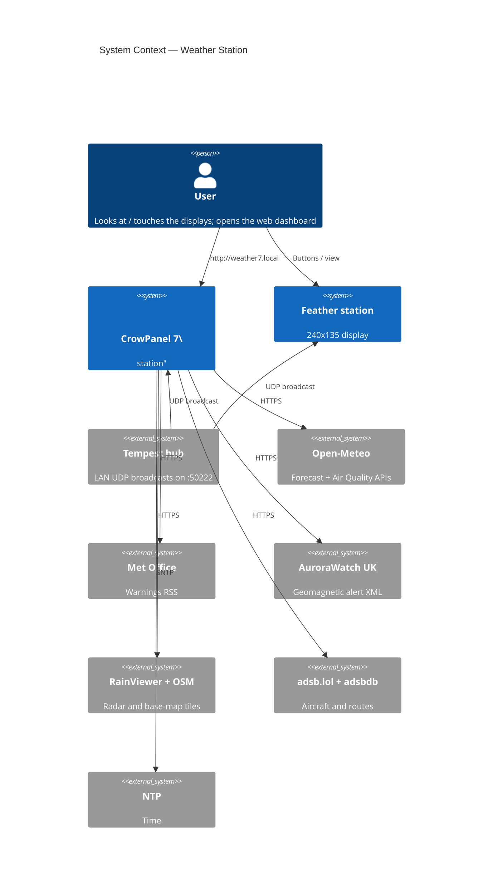
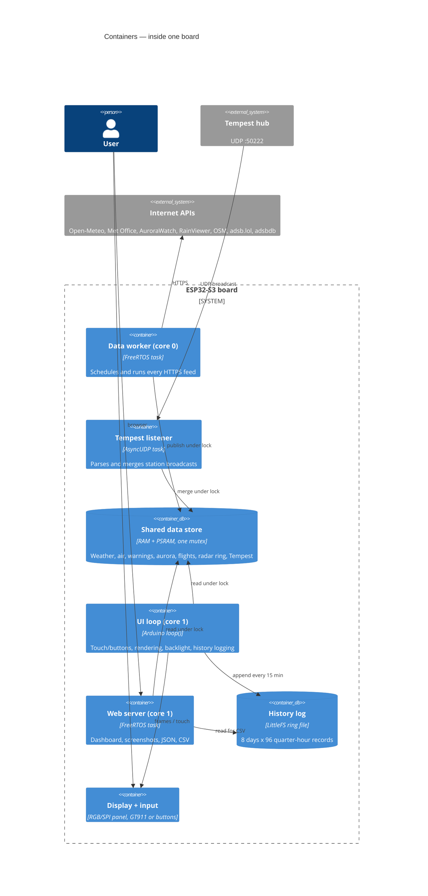
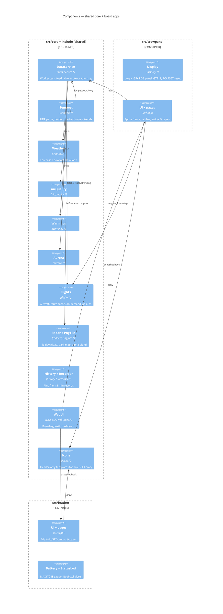
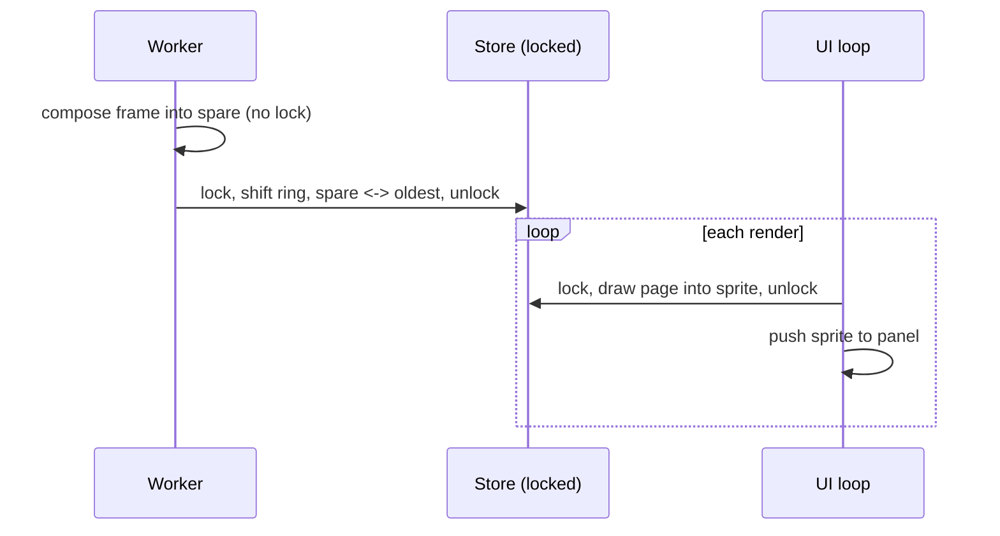
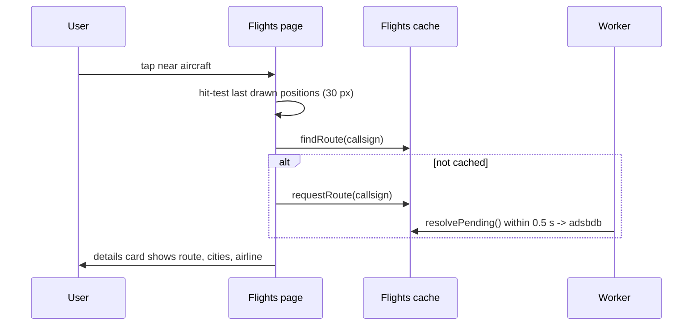

# Weather Station — Design

Firmware for two ESP32-S3 displays that share one core:

| Board | Display | Input | UI |
|---|---|---|---|
| **Elecrow CrowPanel 7" Basic** (ESP32-S3-WROOM-1-N4R8) | 800 × 480 RGB TFT | GT911 capacitive touch | 9 touch pages with a tab bar and swipe |
| **Adafruit Feather ESP32-S3 Reverse TFT** | 240 × 135 ST7789 | 3 buttons | 9 auto-rotating pages |

Both show local conditions, forecast, an animated rain radar with a 2-hour nowcast, air quality, Met Office warnings, AuroraWatch UK alerts, sun and moon, nearby flights, history, and device health. Both also serve a web dashboard on the LAN. Live local conditions come from a **WeatherFlow Tempest** station via its UDP broadcasts.

### Data sources (no accounts or API keys)

| Feature | Source | Transport | Refresh |
|---|---|---|---|
| Live temp, humidity, pressure, wind, rain, UV, solar, lightning | **Tempest hub** (LAN) | UDP broadcast :50222 | 3 s wind, 1 min obs |
| Forecast, 15-min rain nowcast, sun times | Open-Meteo | HTTPS JSON | 10 min |
| Air quality, UV, pollen | Open-Meteo Air Quality (CAMS) | HTTPS JSON | 30 min |
| Weather warnings | Met Office RSS, region `nw`, filtered to Lancashire | HTTPS XML | 15 min |
| Aurora alerts | AuroraWatch UK (Lancaster University) | HTTPS XML | 5 min |
| Radar frames | RainViewer | HTTPS JSON + PNG tiles | 10 min |
| Base map | OpenStreetMap standard tiles, restyled dark on device | HTTPS PNG | once per boot |
| Aircraft | adsb.lol (ODbL) | HTTPS JSON (HTTP/1.1) | 30 s |
| Flight routes | adsbdb | HTTPS JSON | per callsign, cached |
| Moon phase | computed on device | — | — |
| Time | SNTP | UDP | continuous |

---

## 1. C4 Level 1 — System context



The Feather talks to the same external systems; those arrows are left off for readability.

## 2. C4 Level 2 — Containers (one board)



## 3. C4 Level 3 — Components



### Source layout

```
weather-display/
├── platformio.ini            Envs: crowpanel_7 (default), feather_s3_reverse_tft
├── partitions/crowpanel_4mb.csv  3 MB app + 896 KB LittleFS (4 MB flash, no OTA)
├── scripts/                  skip_png_simd.py (build), flash.ps1 (Feather upload helper)
├── include/                  Shared module APIs: config, weather, tempest, radar, flights, ...
├── src/core/                 Shared implementations (+ png_simd_fallback.c)
├── src/crowpanel/            main, display (LovyanGFX), board_config, ui/ (9 pages)
└── src/feather/              main, battery, status_led, ui/ (9 pages)
```

Each environment compiles `src/core` plus its own board folder (`build_src_filter`). Board-specific sizes are passed as build flags: forecast days, hourly samples, radar viewport and frame count, and hostname.

---

## 4. Concurrency

| Task | Core | Does |
|---|---|---|
| `data` worker | 0 | All HTTPS feeds (see table), on-demand route lookups every 0.5 s |
| AsyncUDP | any | Tempest packets → shared store |
| Arduino `loop()` | 1 | Touch/buttons, render, backlight, history |
| `web` | 1 | HTTP server |

- **One data mutex** guards the shared store. Writers fill a private staging object and copy it in under the lock, so a failed fetch never blanks the screen. Readers draw while holding the lock.
- **CrowPanel canvas lock:** the display loop and web snapshots both compose into the one 800×480 sprite, so a second mutex serialises them. Lock order is always canvas → data.
- **Radar ring:** `RADAR_FRAMES` buffers plus one spare. New frames are composed into the spare without a lock, then inserted by moving pointers under the lock (the oldest buffer becomes the new spare). Only frames newer than the newest held are downloaded.



---

## 5. WeatherFlow Tempest

The hub broadcasts JSON to the whole LAN on UDP 50222. Every packet arrived **twice** on this network, so each message type is de-duplicated by its timestamp.

| Message | Used for |
|---|---|
| `rapid_wind` (3 s) | Live compass needle and "Live" speed |
| `obs_st` (1 min) | All readings (see below), trends, rain/lightning totals |
| `evt_precip`, `evt_strike` | Rain-start time; last strike distance/time |
| `device_status` | Sensor battery V, radio RSSI, uptime, fault bits |
| `hub_status` | Hub firmware, Wi-Fi RSSI, uptime |

`obs_st` fields used (in API v171 order): wind lull/avg/gust (m/s → mph), direction, station pressure, temperature, humidity, illuminance, UV, solar radiation, rain in the minute, precipitation type, strike distance and count, battery.

**Derived on device:**

| Value | Method |
|---|---|
| Sea-level pressure | `P × (1 − 0.0065h / (T + 0.0065h + 273.15))^−5.257`, h = `TEMPEST_ELEVATION_M` |
| Feels like | Wind chill below 10 °C (wind over 4.8 km/h), Rothfusz heat index above 26.7 °C |
| Dew point | Magnus formula |
| Rain today / last hour | Sum of per-minute rain; resets at local midnight; restored after reboot from the history log |
| Pressure trend | Change across up to 3 h of 1-minute samples (shown after 30 min) |
| Strikes today / hour | Same scheme as rain |

If no observation has arrived for 5 minutes, the UI falls back to Open-Meteo values and labels the source.

---

## 6. CrowPanel 7" hardware

| Function | Detail |
|---|---|
| MCU | ESP32-S3, 4 MB QIO flash, **8 MB octal PSRAM** (`qio_opi`) |
| Panel | 800×480, 16-bit RGB565 parallel: B 15,7,6,5,4 · G 9,46,3,8,16,1 · R 14,21,47,48,45; DE 41, VSYNC 40, HSYNC 39, PCLK 0 |
| Timing | PCLK 13 MHz, HSYNC 40/48/40, VSYNC 1/31/13 (front/pulse/back), PCLK active-negative |
| Backlight | GPIO 2, PWM; dimmed from one hour after sunset until sunrise |
| Touch | GT911 on I2C 19/20 |
| V3.0 boards | A **PCA9557** at 0x18 drives the GT911's RST (IO0) and INT (IO1). At boot the firmware pulses RST with INT low, so the GT911 answers at **0x5D** (detected automatically) |
| USB | CH340 to UART0 (`ARDUINO_USB_CDC_ON_BOOT=0`) |

### Rendering

- Every page is drawn into a full-screen 16-bit `LGFX_Sprite` in PSRAM, then copied to the panel's frame buffer. That copy takes about 50 ms, and drawing a frame about 150 ms.
- Redraw rate: once a second, every 450 ms on the radar page (animation), and immediately after any tap or page change.
- Fonts: LovyanGFX DejaVu 12–72 px bitmap fonts, plus 72 px drawn at 1.5×. They are ASCII-only, so the degree sign is drawn as a ring.
- Web snapshots: compose the page off-screen, then average 2×2 blocks into a 400×240 image (the sprite stores byte-swapped RGB565).

### Pages and touch

| Page | Content | Touch |
|---|---|---|
| Now | Tempest temp/feels/high-low, humidity, dew point, pressure + trend, rain today, UV/solar; wind compass with live needle; outlook strip with next 8 hours | — |
| Forecast | 24-hour temperature line with rain-probability bars and 3-hourly icons; 7-day cards | — |
| Radar | 520×380 map (~375 × 275 km), 9-frame loop; 2-hour rain chart | Tap map: pause; left/right third steps frames; middle resumes |
| Air | EAQI + scale, pollutants vs WHO guideline, UV, pollen | — |
| Sky | Sun arc with live position, sunrise/sunset, daylight, sunshine; moon phase | — |
| Alerts | Met Office warnings; AuroraWatch level, 24 h chart; Tempest lightning | — |
| Flights | North-up scope with labelled aircraft (colour = altitude); details card | **Tap a plane** to select it and fetch its route; tap empty sky for nearest |
| History | 24 h / 3 d / 7 d charts: temperature, pressure, wind/gust, rain | Range buttons |
| System | Network, Tempest hub/sensor, display health, feed ages | — |

Navigation: tap a tab, swipe left/right, or tap the status-bar icons to open Alerts.

### Flight selection flow



---

## 7. History log (shared)

- Fixed-size records in a LittleFS ring file (`/history.bin`), one per quarter hour, 768 slots (8 days). Layout **v2** adds Tempest fields; a version mismatch starts a fresh log.
- Each record holds:
  - Open-Meteo: temperature, feels-like, humidity, pressure, 15-min rain, wind, gust, direction, weather code
  - Air quality: EAQI, PM2.5
  - Aurora: activity, level
  - Tempest: temperature, humidity, sea-level pressure, average wind, **highest gust and rain total in the interval**, UV, solar, strikes, sensor battery
  - Device: battery (Feather), Wi-Fi RSSI, aircraft count
- The web CSV (`/history.csv?days=N`) has 30 columns. Dashboard charts prefer Tempest series and hide any series with no data.

## 8. Web dashboard (shared)

| Path | Content |
|---|---|
| `/` | Live mirrors of every page (click to enlarge with fast refresh), 24 h / 3 d / 7 d charts, CSV link |
| `/screen.bmp?p=N` | 24-bit BMP of page N: 240×135 (Feather), 400×240 (CrowPanel) |
| `/api/now.json` | Current values, source, page list; CrowPanel adds render timings and last tap |
| `/history.csv?days=N` | History log |

Hostnames: `weather.local` (Feather), `weather7.local` (CrowPanel). Each board plugs into the shared server through `WebUi::Board`: its size, pages, a snapshot hook and extra JSON.

## 9. Memory (CrowPanel)

| Item | Size |
|---|---|
| Panel frame buffer (PSRAM) | 768 KB |
| UI sprite (PSRAM) | 768 KB |
| Radar: 9 frames + spare + base map, 520×380×2 each | ~4.3 MB |
| Tile download buffer + PNG decoder | ~150 KB |
| Free PSRAM at runtime | ~2 MB |
| Free internal RAM at runtime | ~200 KB |
| Flash | ~1.8 MB of the 3 MB app partition |

## 10. Design decisions

| Decision | Why |
|---|---|
| Shared core, per-board UI folders | Data, history and web are identical; only drawing and input differ |
| Header-only templated icons | Same artwork on Adafruit_GFX and LovyanGFX with no virtual-call layer |
| Tempest via UDP, not the cloud API | Local, instant, no token; the hub broadcasts anyway |
| Radar ring + spare | Needed memory is (frames + 2) × frame size, not twice the loop |
| On-demand route lookups through the worker | The UI never blocks on HTTPS; results are cached for every later tap |
| Render at 1 fps except radar | A full frame costs ~200 ms; constant redraws starved web snapshots |
| OSM tiles restyled dark | CARTO now needs an API key; OSM tiles are free with attribution and fetched once |
| PCA9557 detection | One binary works on V2.x and V3.0 CrowPanels |
| `png_simd_fallback.c` | PNGdec calls an S3 SIMD routine on generic S3 boards; its assembly needs esp-dsp headers, so a C version replaces it |

## 11. Build and flash

```bash
pio run -e crowpanel_7 -t upload              # CrowPanel (CH340, auto-reset)
pio run -e feather_s3_reverse_tft -t upload   # Feather (see scripts/flash.ps1 on Windows)
pio device monitor -b 115200
```

Touch orientation can be adjusted in `src/crowpanel/board_config.h` (`CP_TOUCH_FLIP`, `CP_TOUCH_ROTATION`), as can the pixel clock and backlight levels.
