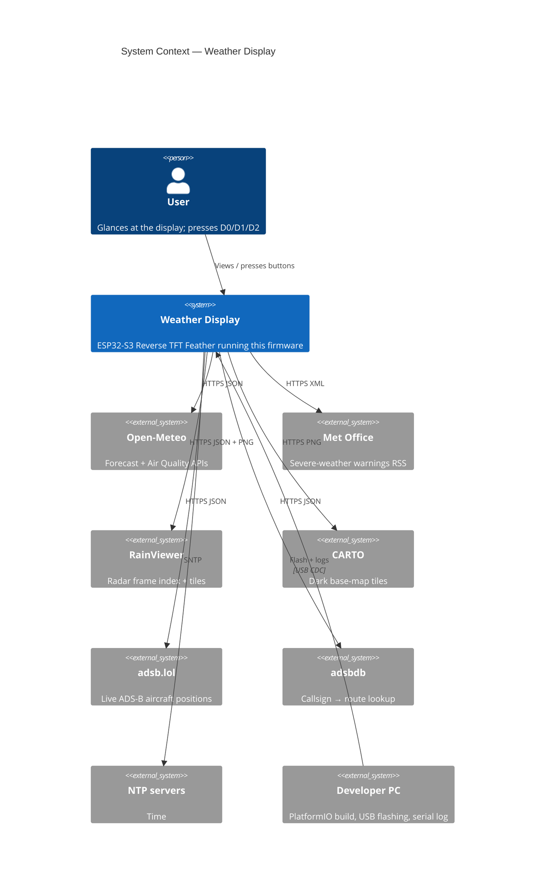
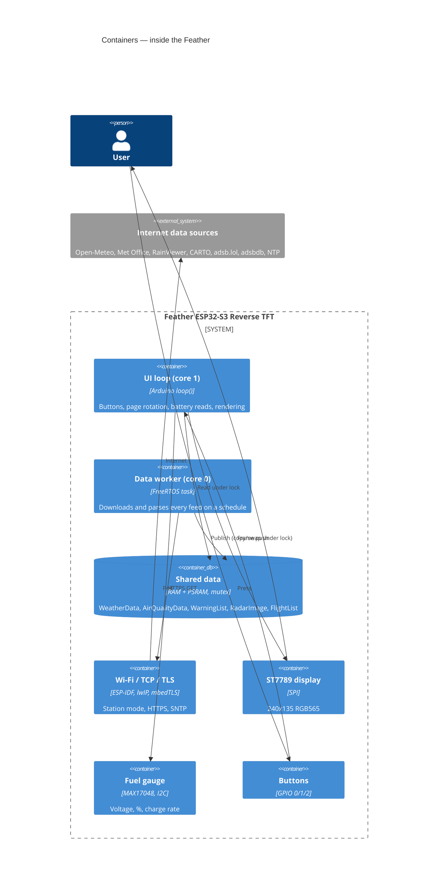
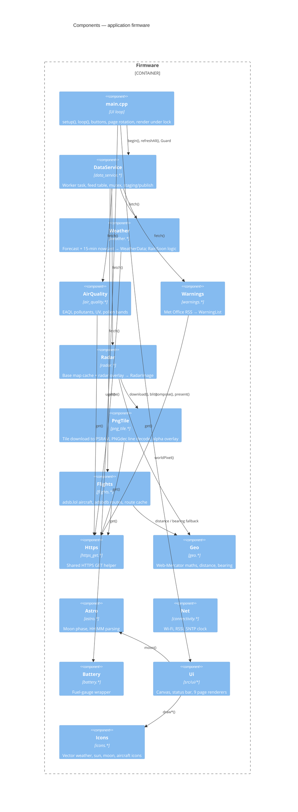
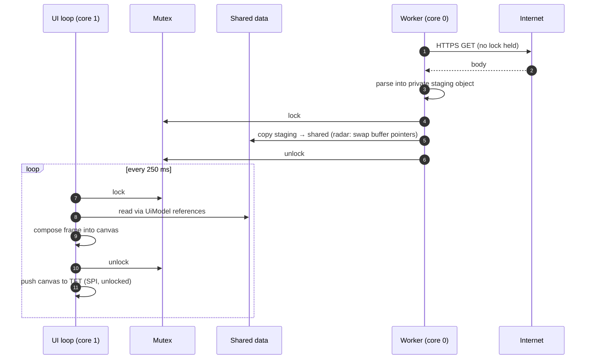
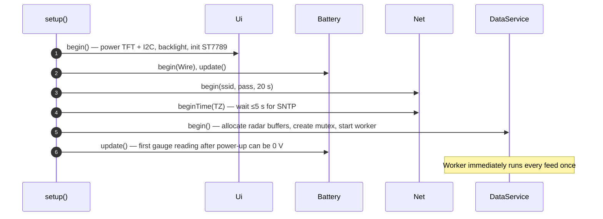
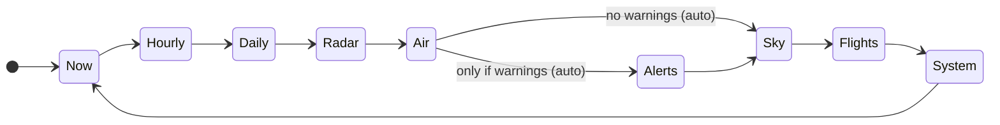
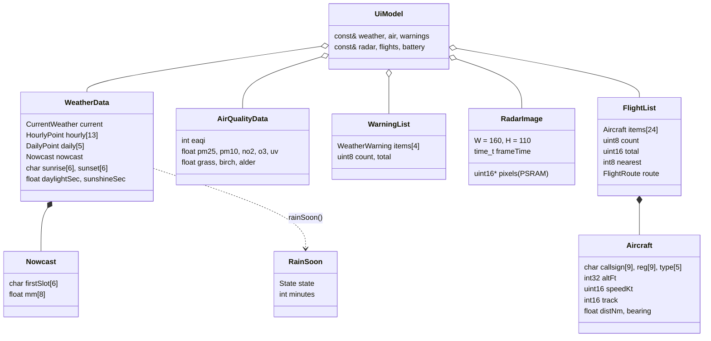
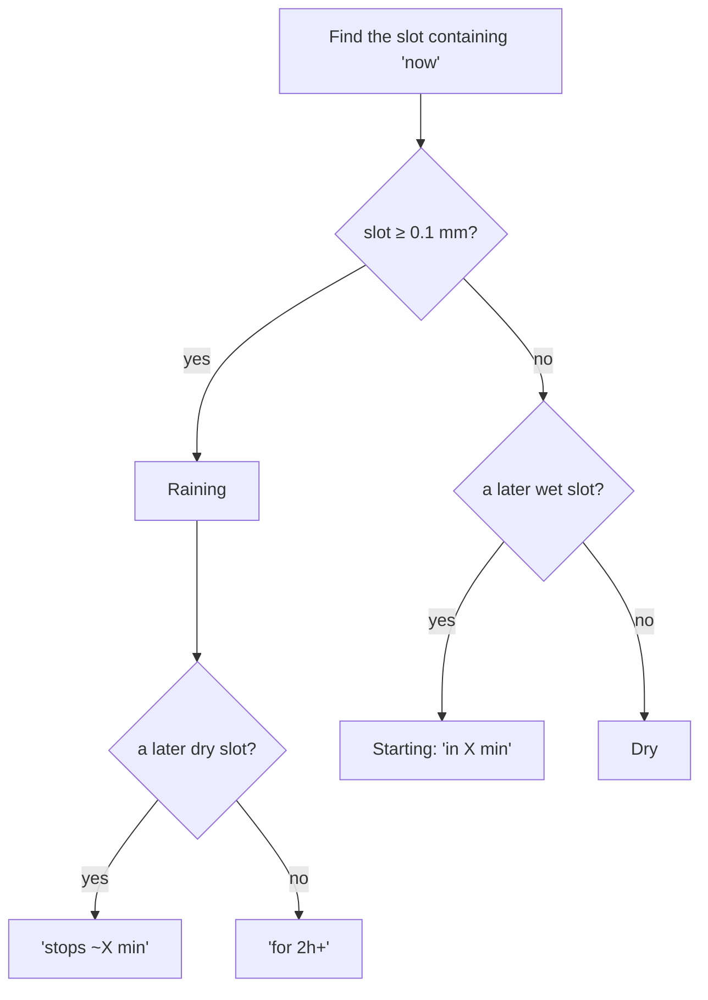

# Weather Display — Design

Firmware for the **Adafruit Feather ESP32-S3 Reverse TFT** that turns the board into a small home weather station. It shows:

- current conditions, an hourly forecast and a 5-day forecast
- a **rain radar** map with a 2-hour "rain soon" forecast
- **air quality** (AQI, pollutants, UV, pollen)
- **Met Office warnings** for Lancashire
- **sun and moon**: sunrise, sunset, day length and moon phase
- **nearby aircraft** with the nearest flight's route
- device health: Wi-Fi signal and battery

| Item | Value |
|---|---|
| MCU | ESP32-S3, dual-core 240 MHz, 2 MB PSRAM, 4 MB flash |
| Display | 1.14" ST7789 IPS, 240 × 135, SPI |
| Battery gauge | MAX17048 (this board) or LC709203F (older revisions), I2C |
| Inputs | D0 = next page, D1 = previous page, D2 = refresh all data |
| Framework | Arduino-ESP32 3.x via PlatformIO |
| Units | °C, mph (wind), 24-hour clock; aviation uses ft and knots |
| Location | 53.826679, −2.452993 (Lancashire), time zone Europe/London |

### Data sources

| Feature | Source | Format | Refresh |
|---|---|---|---|
| Forecast, 15-min rain, sun times | [Open-Meteo](https://open-meteo.com) | JSON | 10 min |
| Air quality, UV, pollen | Open-Meteo Air Quality API (CAMS) | JSON | 30 min |
| Weather warnings | Met Office NSWWS RSS, region `nw` | XML | 15 min |
| Rain radar frames | [RainViewer](https://www.rainviewer.com/api.html) | PNG tiles | 10 min |
| Map under the radar | [CARTO](https://carto.com/basemaps) `dark_all` (© OpenStreetMap) | PNG tiles | once |
| Aircraft positions | [adsb.lol](https://api.adsb.lol) (ODbL) | JSON | 30 s |
| Flight routes | [adsbdb](https://www.adsbdb.com) | JSON | per new nearest flight, cached |
| Moon phase | calculated on the board | — | — |
| Time | SNTP (`pool.ntp.org`, `time.google.com`) | — | continuous |

None of these need an account or API key.

---

## 1. C4 Level 1 — System Context



## 2. C4 Level 2 — Containers

For embedded firmware, the "containers" are the run-time execution units and hardware blocks on the board.



## 3. C4 Level 3 — Components



### Source layout

```
weather-display/
├── platformio.ini            Board, 1.9 MB app partition, libraries, pre-build script
├── scripts/skip_png_simd.py  Excludes PNGdec's unused S3 SIMD assembly from the build
├── Doxyfile                  API docs: `doxygen Doxyfile` → docs/api/html
├── include/                  Public module APIs (one namespace each)
│   ├── config.h              Location, regions, intervals, layout, button pins
│   ├── secrets.h             Wi-Fi credentials (git-ignored)
│   ├── theme.h               RGB565 palette
│   ├── connectivity.h        Net::
│   ├── battery.h             Battery:: + BatteryStatus
│   ├── https_get.h           Https::get()
│   ├── weather.h             Weather:: + WeatherData, Nowcast, RainSoon
│   ├── air_quality.h         AirQuality:: + AirQualityData
│   ├── warnings.h            Warnings:: + WarningList
│   ├── geo.h                 Geo::
│   ├── png_tile.h            PngTile::
│   ├── radar.h               Radar:: + RadarImage
│   ├── flights.h             Flights:: + FlightList, Aircraft, FlightRoute
│   ├── astro.h               Astro:: + MoonInfo
│   ├── data_service.h        DataService:: (worker task + shared data)
│   ├── icons.h               Icons::
│   └── ui.h                  Ui::, Page, UiModel
├── src/                      Implementations + main.cpp
│   └── ui/                   ui.cpp (canvas, status bar), ui_draw.h (internal),
│                             pages_weather, pages_environment, page_radar,
│                             page_sky, page_flights, page_system
└── docs/DESIGN.md            This document
```

Each module exposes a small namespace API in `include/` and keeps its state private in an anonymous namespace. Data flows one way: **worker → shared data → renderer**.

> **Naming note:** the connectivity module isn't called `network.h`. Arduino-ESP32 3.x has its own `Network.h`, and on Windows (case-insensitive file names) a local `network.h` shadows it and breaks the WiFi library.

---

## 4. Concurrency

Network calls take 0.5–3 s each. A radar refresh downloads up to 5 files, so doing this on the UI loop would freeze buttons and the clock. Downloads therefore run in a **FreeRTOS worker task on core 0** (alongside the Wi-Fi stack). The Arduino `loop()` on **core 1** only reads data.



Rules:

- The lock is held only for memory copies (worker) or canvas drawing (UI, ≈10 ms), never during network I/O or SPI.
- A failed or partial fetch never touches shared data, so the last good data stays on screen.
- The radar uses **double buffering**: the worker composes into `radarStaging`, then `std::swap` exchanges it with `radarShared`. Only the pixel pointers move.
- `DataService::refreshAll()` (D2) sets an atomic flag; the worker runs every feed on its next tick.

### Feed scheduling

Feeds are a table in `data_service.cpp`, so adding a source is one entry:

| Feed | Interval | Retry after failure |
|---|---|---|
| weather | 10 min | 60 s |
| air | 30 min | 60 s |
| warnings | 15 min | 60 s |
| flights | 30 s | 60 s |
| radar | 10 min | 60 s |

### Start-up



### Page navigation



D0 moves forward and D1 back through all nine pages. Auto-rotation (every 12 s) skips Alerts when there are no warnings.

---

## 5. Data model



---

## 6. Features in detail

### 6.1 Rain radar

The radar map is a 160 × 110 px window centred on home at slippy-map **zoom 7** (≈0.72 km per pixel at this latitude), so it covers about **115 × 80 km**.

1. **Geometry:** `Geo::worldPixel()` converts home to global Web-Mercator pixels. The window's top-left corner is that point minus half the window size. It overlaps at most 2 × 2 tiles of 256 px.
2. **Base map:** CARTO `dark_all` tiles are downloaded once, decoded into a cached PSRAM buffer, and reused for every frame.
3. **Radar frame:** `weather-maps.json` gives the newest frame's path. Each overlapping RainViewer tile (`/256/7/x/y/2/1_1.png`, RGBA) is decoded line by line, and only pixels with alpha ≥ 96 are copied over the base map (PNGdec `getAlphaMask`).
4. **Display:** the composed frame is blitted straight into the canvas, with a crosshair at home, the frame time, and the required attribution: *© OSM CARTO RainViewer*.

Memory: base map + 2 frame buffers = 3 × 35 KB, a 96 KB download buffer and the ~50 KB PNG decoder, all in **PSRAM**. That keeps internal RAM free for TLS (about 140 KB stays free).

> RainViewer's free tiles go up to zoom 7. Higher zooms return an empty placeholder.

### 6.2 Rain coming soon (nowcast)

Open-Meteo `minutely_15=precipitation&forecast_minutely_15=8` returns 2 hours in 15-minute slots. `Weather::rainSoon()` turns this into a status:



Minutes are measured from the actual clock to the slot start and rounded to 5. The Now page shows "Rain 25m" or "Raining" in place of the daily chance whenever rain is imminent. The Radar page shows the headline, a detail line and an 8-bar chart; bar height scales with √mm so drizzle is still visible, and heavy slots are yellow.

### 6.3 Sun & moon

- **Sun:** sunrise, sunset, daylight length and sunshine hours come from Open-Meteo's daily fields. A dotted arc shows the sun's position between sunrise and sunset.
- **Moon:** calculated on the board in `Astro::moon()` from a mean synodic month (29.530588853 days) and a reference new moon (2000-01-06 18:14 UTC). It gives phase (0–1), age, lit fraction `(1 − cos 2πp)/2`, the phase name (8 sectors), and the next full and new moon. Accuracy is within about ±0.5 day, which is fine for showing a date.
- **Moon drawing:** `Icons::moon()` fills each row of the disc. While waxing, the lit part runs from `x = w·cos(2πp)` to the right edge; while waning, it runs from the left edge to `x = −w·cos(2πp)`. This gives a correct crescent, quarter or gibbous shape for the northern hemisphere.

### 6.4 Flight tracking

- **Positions:** `GET https://api.adsb.lol/v2/point/{lat}/{lon}/25`. The JSON is parsed with an ArduinoJson **filter** that keeps only callsign, registration, type, altitude, ground speed, track, position, distance and direction. The nearest 24 aircraft are kept, sorted by distance.
- **Routes:** the nearest airborne aircraft's callsign is looked up on adsbdb (`/v0/callsign/{cs}`) to get the airline and origin/destination codes. Results, including "unknown", are cached for 12 callsigns, so each flight costs at most one lookup.
- **HTTP/1.1:** adsb.lol rejects HTTP/1.0 (status 426). These two calls use `Https::get(..., http10 = false)` and parse `getString()`, which decodes chunked responses. The large String goes to PSRAM.
- **Scope:** north-up, centred on home. The outer ring is 25 nm and the inner ring 12.5 nm. Each aircraft is an arrow rotated to its track, and the nearest is a larger yellow silhouette.

---

## 7. Screen design (240 × 135)

All pages share an 18 px status bar and nine page dots at the bottom.

```
┌────────────────────────────────────────────────┐
│14:32  Sat 07 Nov          ⚠  ▂▄▆█  87% [███▯] │ status bar (⚠ only with warnings)
├────────────────────────────────────────────────┤
│  ☁☀    9 °C                       H 11         │ NOW
│  Overcast                         L  6         │
│  Feels 8  Hum 87%                              │
│  3mph SW                       Rain 25m        │ ← nowcast beats daily %
│               ● ○ ○ ○ ○ ○ ○ ○ ○                │
└────────────────────────────────────────────────┘

 RADAR                                SKY
 ┌──────────────────────┬─────────┐   ┌──────────────┬──────────────┐
 │17:20                 │Rain 2h  │   │   . ☀ .      │    (moon)    │
 │    map + radar  ⊕    │in 25m   │   │ .       .    │Waxing gibbous│
 │                      │rain com.│   │ ───────────  │   78% lit    │
 │                      │ ▁▂▅█▅▂  │   │ ↑07:21 ↓16:24│Full Sat 14Nov│
 │(c)OSM CARTO RainView.│now  +2h │   │ Day 9h03m    │New  Sun 29Nov│
 └──────────────────────┴─────────┘   └──────────────┴──────────────┘

 FLIGHTS                              AIR / ALERTS / SYSTEM
 ┌──────────────┬───────────────┐     as before: AQI + scale, PM, NO2, O3,
 │   N  ✈       │EZY98CD        │     UV, pollen / warning cards or ✓ /
 │  ( · ✈ )     │EDI>CDG        │     Wi-Fi, IP, battery, uptime, RAM, PSRAM
 │     ✈        │easyJet        │
 │25nm          │A20N G-UZHA    │
 │              │37,000ft 437kt │
 │              │5.8nm SE  5 ac │
 └──────────────┴───────────────┘
```

### Icons (`icons.cpp`, all vector, no bitmaps)

| Icon | Drawn as |
|---|---|
| Weather (10 kinds) | Sun/moon, clouds, rain, drizzle, snow, sleet, fog, lightning on a 48-unit grid, scaled per use |
| Sunrise / sunset | Half sun on a horizon with rays and an up/down arrow |
| Moon phase | Row-filled disc, lit/earthshine shading by phase |
| Aircraft | Nose, fuselage, wings and tail triangles rotated to track (arrowhead below 12 px) |
| Warning | Triangle with "!" in yellow/amber/red |
| Wi-Fi / battery | 4 bars / outline with fill and charge bolt |

---

## 8. Memory and flash

| Resource | Use |
|---|---|
| Flash | ≈1.45 MB of the 1.9 MB app slot (`min_spiffs.csv`, which keeps two OTA slots) |
| Internal RAM | ≈84 KB static, ≈140 KB free at runtime (TLS needs ~45 KB per connection) |
| PSRAM | Radar buffers, PNG decoder, tile download buffer, large JSON/Strings; ≈1.8 MB free |
| Worker stack | 16 KB |

The partition table was changed from Adafruit's TinyUF2 layout (1.4 MB app) to `min_spiffs.csv`. UF2 drag-and-drop flashing is therefore not available; flashing is over USB with esptool as normal.

---

## 9. Design decisions

| Decision | Rationale |
|---|---|
| **Worker task + mutex** | Keeps the UI responsive while radar and flight downloads run; the lock is held only for memory copies. |
| **Stage, then publish** | Every fetcher fills a private object; failures never blank the screen. |
| **Double-buffered radar** | Swapping pointers avoids copying 35 KB under the lock. |
| **PNGdec, line by line** | A full RGBA 256² tile would be 256 KB; line decoding needs about 1 KB of line buffers. |
| **Base map cached once** | Static imagery; saves 4 downloads per radar refresh and respects CARTO's usage limits. |
| **ArduinoJson filters** | adsb.lol responses include ~40 fields per aircraft; filtering keeps memory proportional to what's used. |
| **adsb.lol, not OpenSky/airplanes.live** | No account, no tight daily credit limit; airplanes.live now requires approval (403). |
| **Moon phase computed locally** | No API needed; mean-month accuracy is enough for a phase picture and dates. |
| **`setInsecure()` TLS** | All data is public; avoids bundling and rotating CA certificates. Use `setCACert()` if required. |
| **Pre-build script for PNGdec** | Its ESP32-S3 SIMD `.S` file is dead code on this board and needs esp-dsp headers the assembler can't find. |
| **Config in headers** | Location, regions, radius and timings are compile-time constants. |

## 10. Build, flash, monitor

```bash
pio run                      # build
pio run -t upload            # flash (auto-detects the port)
pio device monitor           # 115200 baud serial log
```

If upload says *"A device which does not exist was specified"*, the board has re-enumerated into its ROM bootloader on a new COM port (USB ID 303A:1001). Upload again to that port: `pio run -t upload --upload-port COM8`.

To force the bootloader manually: hold **D0**, tap **Reset**, release **D0**.

Test Met Office parsing against the UK-wide feed (PowerShell):

```powershell
$env:PLATFORMIO_BUILD_FLAGS = '-DWARNING_REGION=\"UK\" -DWARNING_AREA_FILTER=\"\"'
pio run -t upload
Remove-Item Env:PLATFORMIO_BUILD_FLAGS
```

## 11. Possible extensions

- Radar animation: loop the last 6–12 RainViewer frames (≈35 KB each in PSRAM).
- Deep sleep between refreshes for long battery life (screen off, wake on D0).
- Wi-Fi setup from a phone via a temporary hotspot instead of compile-time credentials.
- OTA firmware updates (the partition table already has two app slots).
- Indoor sensor on the STEMMA QT port (BME280 / SHT40 / SCD-40 CO₂).
- Flight alerts: flash the NeoPixel for low or interesting aircraft (military, helicopters, specific types).
