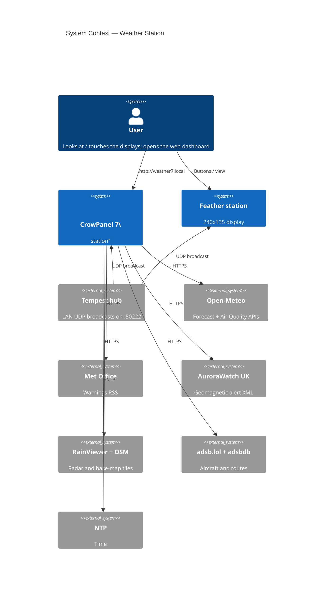
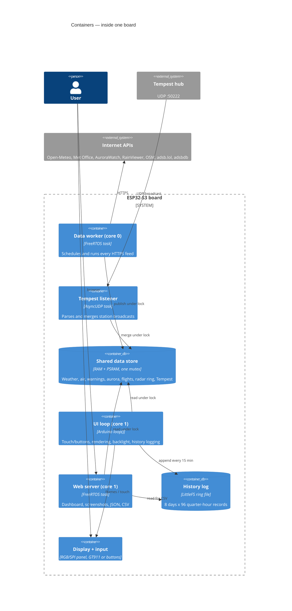
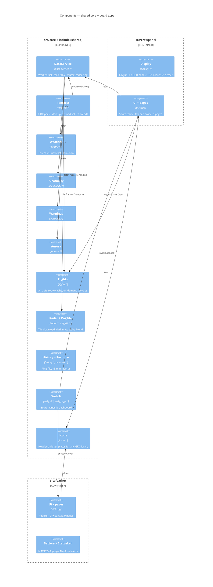
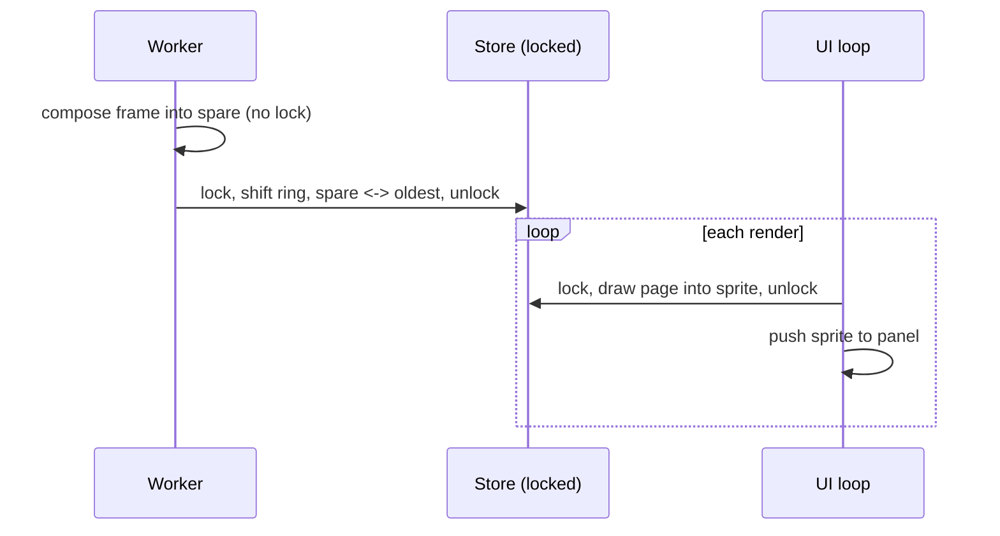
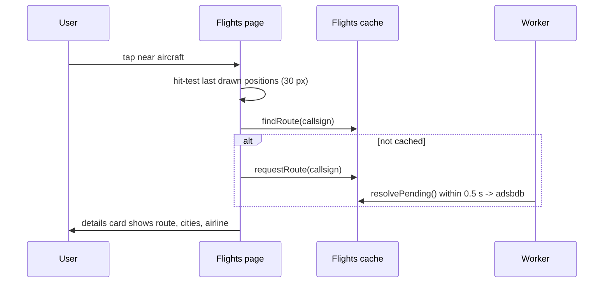

# Weather Station — Design

Firmware for two ESP32-S3 displays that share one core:

| Board | Display | Input | UI |
|---|---|---|---|
| **Elecrow CrowPanel 7" Basic** (ESP32-S3-WROOM-1-N4R8) | 800 × 480 RGB TFT | GT911 capacitive touch | 9 touch pages with a tab bar and swipe |
| **Adafruit Feather ESP32-S3 Reverse TFT** | 240 × 135 ST7789 | 3 buttons | 9 auto-rotating pages |

Both show local conditions, forecast, an animated rain radar with a 2-hour nowcast, air quality, Met Office warnings, AuroraWatch UK alerts, sun and moon, nearby flights, history, and device health. Both also serve a web dashboard on the LAN. Live local conditions come from a **WeatherFlow Tempest** station via its UDP broadcasts.

### Data sources (no accounts or API keys)

| Feature | Source | Transport | Refresh |
|---|---|---|---|
| Live temp, humidity, pressure, wind, rain, UV, solar, lightning | **Tempest hub** (LAN) | UDP broadcast :50222 | 3 s wind, 1 min obs |
| Forecast, 15-min rain nowcast, sun times | Open-Meteo | HTTPS JSON | 10 min |
| Air quality, UV, pollen | Open-Meteo Air Quality (CAMS) | HTTPS JSON | 30 min |
| Weather warnings | Met Office RSS, region `nw`, filtered to Lancashire | HTTPS XML | 15 min |
| Aurora alerts | AuroraWatch UK (Lancaster University) | HTTPS XML | 5 min |
| Radar frames | RainViewer | HTTPS JSON + PNG tiles | 10 min |
| Base map | OpenStreetMap standard tiles, restyled dark on device | HTTPS PNG | once per boot |
| Aircraft | adsb.lol (ODbL) | HTTPS JSON (HTTP/1.1) | 20 s |
| Flight routes | adsbdb | HTTPS JSON | per callsign, cached |
| Aircraft photos | planespotters.net (credit shown; User-Agent with contact URL required) | HTTPS JSON + progressive JPEG | per aircraft, cached |
| Grid carbon intensity | carbonintensity.org.uk, region 3 (North West England) | HTTPS JSON | 30 min |
| NAS health | Glances REST API v4 (LAN, no login) | HTTP JSON | 60 s |
| Internet speed | Speedtest Tracker `/api/speedtest/latest` (LAN) | HTTP/1.0 JSON | 60 s |
| Service monitors | Uptime Kuma public status page (LAN) | HTTP JSON | 60 s |
| Sonos | UPnP SOAP `GetTransportInfo` / `GetPositionInfo` on :1400 (LAN, read-only) | HTTP XML | 60 s |
| Home Assistant | `POST /api/template` with a long-lived token (LAN) | HTTP JSON | 60 s |
| Moon phase | computed on device | — | — |
| Time | SNTP | UDP | continuous |

---

## 1. C4 Level 1 — System context



The Feather talks to the same external systems; those arrows are left off for readability.

## 2. C4 Level 2 — Containers (one board)



## 3. C4 Level 3 — Components



### Source layout

```
weather-display/
├── platformio.ini            Envs: crowpanel_7 (default), feather_s3_reverse_tft
├── partitions/crowpanel_4mb.csv  3 MB app + 896 KB LittleFS (4 MB flash, no OTA)
├── scripts/                  skip_png_simd.py (build), flash.ps1 (Feather upload helper)
├── include/                  Shared module APIs: config, weather, tempest, radar, flights, ...
├── src/core/                 Shared implementations (+ png_simd_fallback.c)
├── src/crowpanel/            main, display (LovyanGFX), board_config, ui/ (9 pages)
└── src/feather/              main, battery, status_led, ui/ (9 pages)
```

Each environment compiles `src/core` plus its own board folder (`build_src_filter`). Board-specific sizes are passed as build flags: forecast days, hourly samples, radar viewport and frame count, and hostname.

---

## 4. Concurrency

| Task | Core | Does |
|---|---|---|
| `data` worker | 0 | All HTTPS feeds (see table), on-demand route lookups every 0.5 s |
| AsyncUDP | any | Tempest packets → shared store |
| Arduino `loop()` | 1 | Touch/buttons, render, backlight, history |
| `web` | 1 | HTTP server |
| `nettest` | 0 | One-shot network test (pings, DNS, HTTPS download); yields every 4 KB so the idle task is never starved |
| `monitor` | 0 | Monitor run: two continuous `esp_ping` sessions, the air survey and a 1 s sampler (signal, mesh moves, drop-outs, DNS each minute); exits when the run ends |
| Wi-Fi driver callback | 0 | Air survey (promiscuous mode): per-frame counters and small MAC sets under a spinlock; nothing else |

- **CPU-bound work yields.** The radar rain-motion search (`Radar::estimate`) and the speed-test download both call `vTaskDelay(1)` regularly. Without it, the extra Wi-Fi load on core 0 starved the idle task and the task watchdog reset the board about a minute after boot (found from the core dump, see Logging).
- **Wi-Fi survey** runs from the UI loop as an asynchronous scan every minute. Scans are held off while a test or monitor runs, because a scan takes the radio off-channel for about 2 s and would show up as 500 ms lag spikes.
- **Logging:** `Log::printf` may be called from any task; lines go to serial, a RAM tail and an SD buffer under a small mutex. Only the UI loop writes the buffer to the card (every 5 s).

- **One data mutex** guards the shared store. Writers fill a private staging object and copy it in under the lock, so a failed fetch never blanks the screen. Readers draw while holding the lock.
- **CrowPanel canvas lock:** the display loop and web snapshots both compose into the one 800×480 sprite, so a second mutex serialises them. Lock order is always canvas → data.
- **Radar ring:** `RADAR_FRAMES` buffers plus one spare. New frames are composed into the spare without a lock, then inserted by moving pointers under the lock (the oldest buffer becomes the new spare). Only frames newer than the newest held are downloaded.



---

## 5. WeatherFlow Tempest

The hub broadcasts JSON to the whole LAN on UDP 50222. Every packet arrived **twice** on this network, so each message type is de-duplicated by its timestamp.

| Message | Used for |
|---|---|
| `rapid_wind` (3 s) | Live compass needle and "Live" speed |
| `obs_st` (1 min) | All readings (see below), trends, rain/lightning totals |
| `evt_precip`, `evt_strike` | Rain-start time; last strike distance/time |
| `device_status` | Sensor battery V, radio RSSI, uptime, fault bits |
| `hub_status` | Hub firmware, Wi-Fi RSSI, uptime |

`obs_st` fields used (in API v171 order): wind lull/avg/gust (m/s → mph), direction, station pressure, temperature, humidity, illuminance, UV, solar radiation, rain in the minute, precipitation type, strike distance and count, battery.

**Derived on device:**

| Value | Method |
|---|---|
| Sea-level pressure | `P × (1 − 0.0065h / (T + 0.0065h + 273.15))^−5.257`, h = `TEMPEST_ELEVATION_M` |
| Feels like | Wind chill below 10 °C (wind over 4.8 km/h), Rothfusz heat index above 26.7 °C |
| Dew point | Magnus formula |
| Rain today / last hour | Sum of per-minute rain; resets at local midnight; restored after reboot from the history log |
| Pressure trend | Change across up to 3 h of 1-minute samples (shown after 30 min) |
| Strikes today / hour | Same scheme as rain |

If no observation has arrived for 5 minutes, the UI falls back to Open-Meteo values and labels the source.

---

## 6. CrowPanel 7" hardware

| Function | Detail |
|---|---|
| MCU | ESP32-S3, 4 MB QIO flash, **8 MB octal PSRAM** (`qio_opi`) |
| Panel | 800×480, 16-bit RGB565 parallel: B 15,7,6,5,4 · G 9,46,3,8,16,1 · R 14,21,47,48,45; DE 41, VSYNC 40, HSYNC 39, PCLK 0 |
| Timing | PCLK 13 MHz, HSYNC 40/48/40, VSYNC 1/31/13 (front/pulse/back), PCLK active-negative |
| Backlight | GPIO 2, PWM; dimmed from one hour after sunset until sunrise |
| Touch | GT911 on I2C 19/20 |
| V3.0 boards | A **PCA9557** at 0x18 drives the GT911's RST (IO0) and INT (IO1). At boot the firmware pulses RST with INT low, so the GT911 answers at **0x5D** (detected automatically) |
| USB | CH340 to UART0 (`ARDUINO_USB_CDC_ON_BOOT=0`) |

### Rendering

- Every page is drawn into a full-screen 16-bit `LGFX_Sprite` in PSRAM, then copied to the panel's frame buffer. That copy takes about 50 ms, and drawing a frame about 150 ms.
- Redraw rate: once a second, every 450 ms on the radar page (animation), and immediately after any tap or page change.
- Fonts: LovyanGFX DejaVu 12–72 px bitmap fonts, plus 72 px drawn at 1.5×. They are ASCII-only, so the degree sign is drawn as a ring.
- Web snapshots: compose the page off-screen, then average 2×2 blocks into a 400×240 image (the sprite stores byte-swapped RGB565).

### Pages and touch

| Page | Content | Touch |
|---|---|---|
| Grid | Carbon intensity now + band, low-carbon share, greenest 3 h in the next day, generation mix, 48 h forecast | — |
| Home | Home Assistant: temperatures, humidity, people, lights, open doors/windows, heating, biggest power users; setup steps until a token is saved | — |
| Lab | NAS CPU/memory/disk/temperature and container health, internet speed, Sonos now playing, Uptime Kuma services (down ones as chips) | — |
| Now | Tempest temp/feels/high-low, humidity, dew point, pressure + trend, rain today, UV/solar; wind compass with live needle; outlook strip with next 8 hours | — |
| Forecast | 24-hour temperature line with rain-probability bars and 3-hourly icons; 7-day cards | — |
| Radar | 520×380 map (~375 × 275 km), 9-frame loop; 2-hour rain chart | Tap map: pause; left/right third steps frames; middle resumes |
| Air | EAQI + scale, pollutants vs WHO guideline, UV, pollen | — |
| Sky | Sun arc with live position, sunrise/sunset, daylight, sunshine; moon phase | — |
| Alerts | Met Office warnings; **frost & ice risk**; AuroraWatch level, 24 h chart; Tempest lightning | — |
| Flights | North-up scope with labelled aircraft (colour = altitude) and **trails**; details card with **photo**, route, cities, airline. **List** view: every aircraft kept (up to 48), nearest first, with type, registration, altitude, speed, climb, distance, bearing and route | **Tap a plane** to select it; tap empty sky for nearest. **List** / **Scope** toggles the view; drag or arrows scroll the list; tap a row to show it on the scope. **Radius - / +** (5 to 100 nm) re-polls at once and is saved |
| History | **Summary** (today, yesterday, records over 7/30/90 days) or charts over 24 h / 7 d / 30 d / 90 d | Mode buttons |
| Network: Signal | Live signal of the joined access point with a -90 to -40 dBm scale; every network in range (scan each minute); 3-hour signal history of the strongest six | Tap a network to highlight it on the graph; drag or arrows scroll |
| Network: Crowding | 2.4 GHz channel map (networks per channel coloured by signal; your system vs neighbours; quietest of 1/6/11) and a 20 s air survey: devices on your Wi-Fi, neighbours, air busy, re-sent frames, beacon overhead, busiest devices | Listen 20 s |
| Network: Test | What the test does, then results: router and internet ping (avg, max, jitter, loss), DNS, download speed, verdict and a plain-English diagnosis | Run test |
| Network: Monitor | 15 min to 8 h glitch watch. Views: Ping (router/internet average, worst, lost), Signal (average/weakest, mesh moves, drop-outs), Air (devices, air busy %, re-sent %) and Events (drop-outs with reason, back after N s, mesh moves, spikes >500 ms, loss bursts, DNS failures, weak signal, busy channel); totals and a verdict | Duration chips, Start / Stop, view chips; drag to scroll events |
| Network: Help | What each figure means and how to track down a problem | - |
| System: Status | Network, Tempest hub/sensor, display health, SD card, feed ages | - |
| System: Settings | Auto page on/off, seconds per page, **which pages it rotates through**; sleep mode on/off with sleep and wake times; day/night backlight | Toggles and steppers; saved to flash 3 s after the last tap |

**Navigation.** The bottom bar has seven groups (Weather, Air, Flights, History, Home, Network, System); a group's pages appear as sub-tabs in the middle of the status bar, and dots under each bottom tab show how many pages it has. Tapping a group reopens the page last used in it; tapping the open group again moves to its next page. Swipe left/right steps through every page in order; drag up/down scrolls list pages. The status-bar icons open Alerts.

**Auto page.** When on, the panel moves to the next ticked page every N seconds (5 s to 10 min). It waits a minute after any touch, never leaves the Settings page, and holds still while a network test or monitor is running.

**Sleep mode.** Between the sleep and wake times (the window may cross midnight) the backlight is off and nothing is drawn. A touch wakes the screen for a minute; that first touch is swallowed so it cannot press anything. Nothing else stops: data, history, the web server and any monitor keep running.

### Flight selection flow



---

### New derived features

| Feature | How |
|---|---|
| **Rain rate** | Tempest 1-minute rain x 60 = mm/h, with peak today and peak per history interval; Met Office intensity bands (light < 2.5, moderate < 10, heavy < 50 mm/h). The Now page shows "Raining now" from the Tempest before any forecast. |
| **Frost & ice risk** (`frost.*`) | Rules on Tempest air temperature, dew point and wet surfaces (rain in the last hour/day), plus the forecast minimum over the next 12 h; shown as a chip on Now, a card on Alerts, and a status-bar chip at Moderate+. |
| **Radar rain arrival** (`Radar::estimate`) | Rain mask = pixels differing from the cached base map, on a 4 px grid. Motion = the shift (within +/-8 cells, ~23 km) that best overlaps consecutive frames, averaged over the last 3 pairs. From home, walk upwind in a 5-cell corridor to the first rain; distance / speed = minutes. Computed after each radar refresh; shown on Radar and Now. |
| **Plane trails** | Each poll carries forward the previous positions of aircraft still in range (matched by ICAO hex), up to 10 points (~3 min at 20 s polls). |
| **Aircraft photos** | `requestPhoto(hex)` -> worker fetches the planespotters thumbnail_large (420x280, progressive JPEG) into a 6-entry PSRAM cache; the UI decodes it once with **stb_image** (TJpgDec can't do progressive) and box-scales it to 210x140. |
| **Records & summaries** | Computed on the History page from the 90-day log: today/yesterday highs and lows with times, strongest gust, rain and peak rate, lightning; 7/30/90-day extremes with dates, total rain, wettest day, wet days. |

## 7. History log (shared)

- Fixed-size 62-byte records, one per quarter hour, in **append-only weekly files** `/hist/w<week>.bin` (week = UTC days / 7) on LittleFS. Retention is `HISTORY_DAYS`: **90 days on the CrowPanel** (~14 files, ~540 KB of 896 KB), 8 days on the Feather (128 KB partition). When a new week starts, files older than the retention are deleted. `/hist/meta.bin` holds the layout version (**v4**) and record size; a mismatch clears the log.
- Why weekly files: LittleFS stores a file as a chain of blocks, so modifying bytes near the start of a large file (as a ring buffer does) rewrites everything after it. That needs free space the size of the file and wears the flash. Appends touch only the last block, and pruning is a file delete.
- Why not SQLite: records are fixed-size and time-ordered, so files already are the index; a 90-day read is one sequential pass. SQLite on ESP32 would add ~400 KB of code plus page-cache RAM for queries that are simple loops here.
- Each record holds:
  - Open-Meteo: temperature, feels-like, humidity, pressure, 15-min rain, wind, gust, direction, weather code
  - Air quality: EAQI, PM2.5
  - Aurora: activity, level
  - Tempest: temperature, humidity, sea-level pressure, average wind, **highest gust and rain total in the interval**, UV, solar, strikes, sensor battery
  - Device: battery (Feather), Wi-Fi RSSI, aircraft count
- The web CSV (`/history.csv?days=N`) has 30 columns. Dashboard charts prefer Tempest series and hide any series with no data.

### Home Assistant summary

Instead of `/api/states` (hundreds of KB), the device POSTs one Jinja template to `/api/template` and Home Assistant renders a compact JSON summary server-side: numeric temperature/humidity/power sensors, persons, climate entities, light counts and open door/window binary sensors. The token is sent as `Authorization: Bearer`.

### Lessons from bring-up

- Uptime Kuma's heartbeat document holds ~100 beats per monitor; building a JSON tree from it exhausted internal RAM and crashed the worker. Only the latest `"status"` per monitor is now read by scanning the text.
- LittleFS stores files as block chains, so rewriting near the start of a large file rewrites the rest of it. The 90-day log therefore uses append-only weekly files (see section 7).

## 8. Web dashboard (shared)

| Path | Content |
|---|---|
| `/` | **Native dashboard** (tabs: Now, Forecast, Radar, Flights, Air & Grid, Sky & Alerts, Home, Lab, History, Mirror, System) |
| `/api/state.json` | Everything the device knows in one ~8 KB JSON document (refreshed by the page every 20 s) |
| `/api/photo?hex=` | Cached aircraft photo (JPEG); 202 while being fetched |
| `/api/lookup?hex=&cs=` | Queue a route + photo lookup for an aircraft |
| `/screen.bmp?p=N` | 24-bit BMP of page N: 240×135 (Feather), 400×240 (CrowPanel) |
| `/api/now.json` | Current values, source, page list; CrowPanel adds render timings and last tap |
| `/history.csv?days=N` | History log (up to `HISTORY_DAYS`; 32 columns incl. rain rate and carbon) |
| `/settings` | Settings form (GET) and save (POST) |
| `/api/settings` | Non-secret settings; secrets only as `"set"` / `"not set"` |

### Native dashboard

The page is rendered in the browser from `/api/state.json`, `/history.csv` and `/api/now.json`; the device only serves JSON (and the page itself from flash).

- **Radar** and **Flights** use Leaflet maps. The browser fetches OpenStreetMap and RainViewer tiles itself, so the maps are zoomable and cost the device nothing. Radar frames animate with a scrubber; the device's own rain-arrival estimate is shown alongside.
- **Flights** plots aircraft at their reported positions with trails, colour by altitude; clicking a plane (or table row) shows its cached photo (`/api/photo`), route, cities and airline, and links to adsb.lol.
- Charts (forecast, 3-hour Tempest trends, grid forecast, aurora, history up to 90 days) use Chart.js.
- **Mirror** keeps the original live screenshots of the device display.
- Chart.js and Leaflet load from cdn.jsdelivr.net / cdnjs.cloudflare.com, so the browser (not the device) needs internet access.

Implementation notes: the JSON is serialised while holding the data lock because ArduinoJson 7 stores `const char[N]` strings by pointer; strings from local variables are copied explicitly; any control byte from external text is replaced with a space so the JSON stays valid.

### Settings page (write-only secrets)

Runtime settings live in NVS (`Preferences`, namespace `wxcfg`) and override the build-time defaults from `config.h`/`secrets.h`. Editable: Home Assistant URL and **token**, NAS host and Glances/Speedtest/Kuma ports, Uptime Kuma slug, Sonos IPs, day/night backlight, Wi-Fi SSID and **password** (applied after restart; falls back to the compiled-in network if it fails), and an optional **settings password**.

- **Secrets are write-only.** Password inputs are never pre-filled; the page and `/api/settings` show only "set"/"not set". A blank field keeps the stored value; a "clear" box removes it.
- When a settings password is set, saving requires it.
- Inputs are validated (ports 1-65535, backlight ranges, URL scheme); an invalid form saves nothing.
- The page is plain HTTP on the LAN: anyone who can reach it can *replace* settings (unless protected) but cannot *read* secrets.

Hostnames: `weather.local` (Feather), `weather7.local` (CrowPanel). Each board plugs into the shared server through `WebUi::Board`: its size, pages, a snapshot hook and extra JSON.

### Network tools and SD logging

| Module | What it does |
|---|---|
| `wifi_scan` | Async scan every 60 s, merged by BSSID into a 3-hour RSSI ring (32 networks x 180 samples, PSRAM) |
| `net_test` | Quick test (20 pings to the gateway, 20 to 1.1.1.1, DNS lookup, 8 s HTTPS download from speed.cloudflare.com) and the monitor (1 Hz pings to both, per-minute log of up to 120 minutes). Verdicts: Good / OK / Poor / Bad for the test; Healthy / Internet issues / Wi-Fi unstable / Wi-Fi problem for the monitor |
| `air_survey` | Promiscuous listening on the joined channel (2.4 GHz). "Yours" = every access point sharing address bytes 1-2 with one broadcasting your SSID (`WifiScan::ownFamily`), so all mesh nodes and their guest/IoT/backhaul SSIDs count. Air time per frame = preamble + size / rate (legacy and HT rates); busy % is a lower bound because undecodable frames are missed |
| `log` | Serial + 16 KB RAM tail + SD card (`/logs/app-YYYY-MM-DD.log`, `/logs/net-YYYY-MM-DD.csv`), 60 days kept. Web: `/logs`, `/logs/file?name=`, `/logs/tail`, `/api/logs`; tests can be started with `POST /api/nettest` (`action=test`, `action=air`, `action=monitor&minutes=60`, `action=stop`); `GET /api/wifi.json` lists every network with its signal history. At boot, `Log::bootReport()` logs the reset reason and, after a crash, the task and backtrace from the flash core dump |

The download figure is what the ESP32 itself manages (single-antenna 2.4 GHz with TLS, typically 1 to 10 Mbps). It is for comparing rooms, not for checking the broadband speed; latency, jitter and loss are the useful measures of lag.

The SD card slot is on SPI: CS 10, MOSI 11, CLK 12, MISO 13. Cards must be FAT32 (cards over 32 GB usually come as exFAT and need reformatting). Mounting tries 20 MHz, then 4 MHz.

**Wi-Fi watchdog.** `Net::maintain()` re-joins after 20 s offline. Auto-reconnect alone did not recover from a failed first association during testing.

### Flash layout

Both boards use the same 4 MB layout: NVS, one 3 MB app slot (no OTA; the firmware has no OTA code), ~900 KB LittleFS for history and a 64 KB core-dump area. The Feather previously used `min_spiffs.csv`, which reserved a second 1.9 MB slot for OTA that was never used; with the new layout it went from 97% to 60% of its slot.

The web dashboard (`include/web_page.h`, ~48 KB of HTML) is gzipped at build time by `scripts/gzip_web_page.py` into a generated header (~16 KB) and served with `Content-Encoding: gzip`.

## 9. Memory (CrowPanel)

| Item | Size |
|---|---|
| Panel frame buffer (PSRAM) | 768 KB |
| UI sprite (PSRAM) | 768 KB |
| Radar: 9 frames + spare + base map, 520×380×2 each | ~4.3 MB |
| Tile download buffer + PNG decoder | ~150 KB |
| Free PSRAM at runtime | ~2 MB |
| Free internal RAM at runtime | ~200 KB |
| Flash | ~1.8 MB of the 3 MB app partition |

## 10. Design decisions

| Decision | Why |
|---|---|
| Shared core, per-board UI folders | Data, history and web are identical; only drawing and input differ |
| Header-only templated icons | Same artwork on Adafruit_GFX and LovyanGFX with no virtual-call layer |
| Tempest via UDP, not the cloud API | Local, instant, no token; the hub broadcasts anyway |
| Radar ring + spare | Needed memory is (frames + 2) × frame size, not twice the loop |
| On-demand route lookups through the worker | The UI never blocks on HTTPS; results are cached for every later tap |
| Render at 1 fps except radar | A full frame costs ~200 ms; constant redraws starved web snapshots |
| OSM tiles restyled dark | CARTO now needs an API key; OSM tiles are free with attribution and fetched once |
| PCA9557 detection | One binary works on V2.x and V3.0 CrowPanels |
| Sub-tabs in the status bar | 14+ pages no longer fit one tab bar; the status bar had spare width, so no page layout had to change |
| Pings from `esp_ping` | Part of ESP-IDF, no extra library; one session per target with callbacks |
| Settings saved 3 s after the last tap | A run of taps on the Settings or Flights page costs one flash write |
| `png_simd_fallback.c` | PNGdec calls an S3 SIMD routine on generic S3 boards; its assembly needs esp-dsp headers, so a C version replaces it |

## 11. Build and flash

```bash
pio run -e crowpanel_7 -t upload              # CrowPanel (CH340, auto-reset)
pio run -e feather_s3_reverse_tft -t upload   # Feather (see scripts/flash.ps1 on Windows)
pio device monitor -b 115200
```

Touch orientation can be adjusted in `src/crowpanel/board_config.h` (`CP_TOUCH_FLIP`, `CP_TOUCH_ROTATION`), as can the pixel clock and backlight levels.
